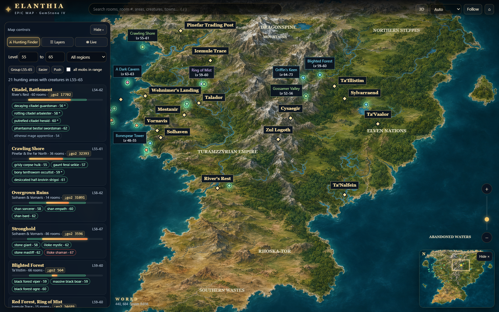

# Changelog

Release notes for EpicMap. The release workflow (`.github/workflows/release.yml`)
publishes the section whose version matches `package.json` as the GitHub release
body, then adds the download, installation and verification sections itself.

How to write a section:

- Heading: `## [X.Y.Z] - YYYY-MM-DD - Release title`. The title becomes the
  release name, `EpicMap vX.Y.Z - Release title`.
- Use `###` headings for the feature sections. The release body shows them as `##`.
- Images may use repository paths, such as `screenshots/example.png`. The workflow
  links them to the tagged commit.
- An optional `### Installation notes` section is added as bullets under the
  generated **Downloads and installation** section rather than shown on its own.

## [1.2.5] - 2026-11-25 - Illustrated World and Steady Navigation

### A new illustrated world

The zoomed-out overview now features new illustrated terrain with shaded mountains, forests, rivers and coastal water. Labels are drawn separately so they remain crisp and avoid town and hunting markers. Addresses #1.

Choose **Illustrated atlas**, **Minimal vector atlas**, or **Original artwork** under **Layers > World background**. Your choice is remembered with your other preferences. The illustration is AI-assisted decorative artwork based on the credited Simutronics map, not a new official geographic survey or route source. Room coordinates, detailed map images and navigation data are unchanged.

### Steadier navigation

- **Zoom stays put:** following between maps preserves your chosen zoom, including long transitions and rapid updates. Area-map dialogs retain zoom too. Optional zoom-to-room applies only when enabling Follow. Addresses #2.
- **Pan without losing Follow:** dragging no longer disables Follow or changes the selected character. Tracking yields during a drag or pinch, then resumes on the next character move. Click Follow or press F to pause intentionally. Addresses #3.
- Includes the wider zoom range, saved preferences and panel controls from the earlier local update.

## [1.2.4] - Wider Zoom Range

Not published as a separate release; first shipped in 1.2.5.

### Wider zoom range

Zoom out four times farther in flat and 3D tilted views. The world-view starting position and maximum zoom-in are unchanged. Saved zoom preferences still work.

## [1.2.3] - 2026-11-09 - Saved Preferences

### Saved preferences

Open **Layers > Preferences**.

- **Remember my preferences:** automatically saves hunting levels, region, strict matching, map layers, effects, tilt, zoom and map position, tracking controls, selected character, trail duration, selected tab, area night ink, and panel visibility. Enabled by default.
- **Save now:** immediately saves your current settings.
- **Reset preferences:** restores defaults.
- Turn remembering off to clear saved settings and keep changes for this visit only.

Settings are saved in the current browser for the same site address. They do not sync across computers. The map still works if browser storage is unavailable.

Includes the independent hide/show controls for the left panel and minimap from v1.2.2.

## [1.2.2] - 2026-11-09 - Full Download

### New in v1.2.2

- Hide the left map controls and minimap independently for a cleaner map view.
- Small Show controls and Show minimap buttons restore each panel.
- Press B for controls or M for the minimap when not typing.
- Panel visibility is remembered when browser storage is available. Hunting filters, in-range glow, and live tracking continue while panels are hidden.

### Included

All map images, room and creature data, hunting finder, live character tracking, fading trails, and the Lich companion script.

## [1.2.1] - 2026-11-09 - Initial Release

EpicMap brings GemStone IV's towns, connected maps, rooms, and hunting areas into one interactive world view, with optional live character tracking through Lich.

### Highlights in v1.2.1

- Cleaner default view with less clutter, location shading, and separate label controls.
- In-range hunting areas glow green by default, with a dedicated toggle independent of other visual effects.
- Hunting filters for level range, region, and whether all creatures must be in range.
- Live tracking for multiple characters, selectable character following, and fading movement trails.
- Reduced browser drawing work through rendering limits and paused rendering on hidden pages.

You can also open `EpicMap/index.html` for offline map browsing and hunting searches. Live tracking requires the Lich script.

Hunting levels use bundled creature data; your build and gear still matter.
