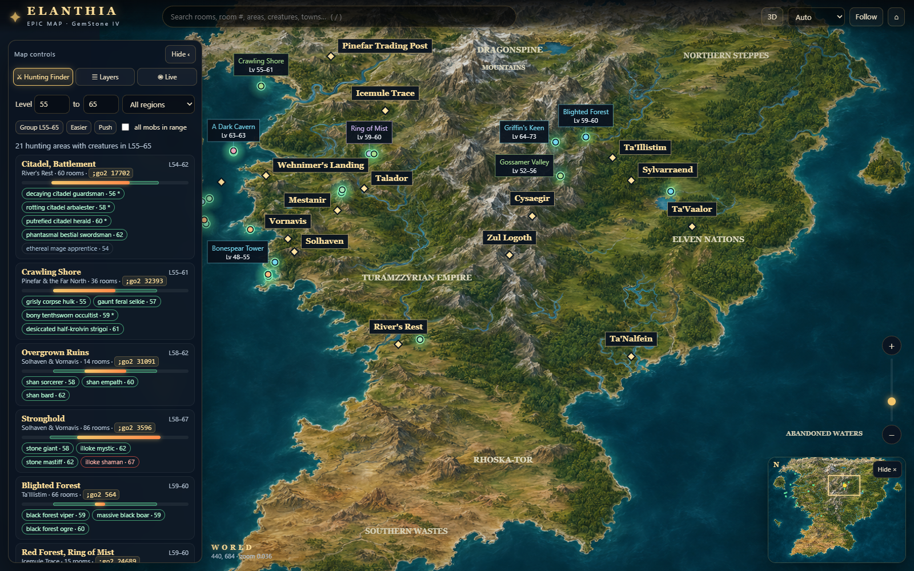
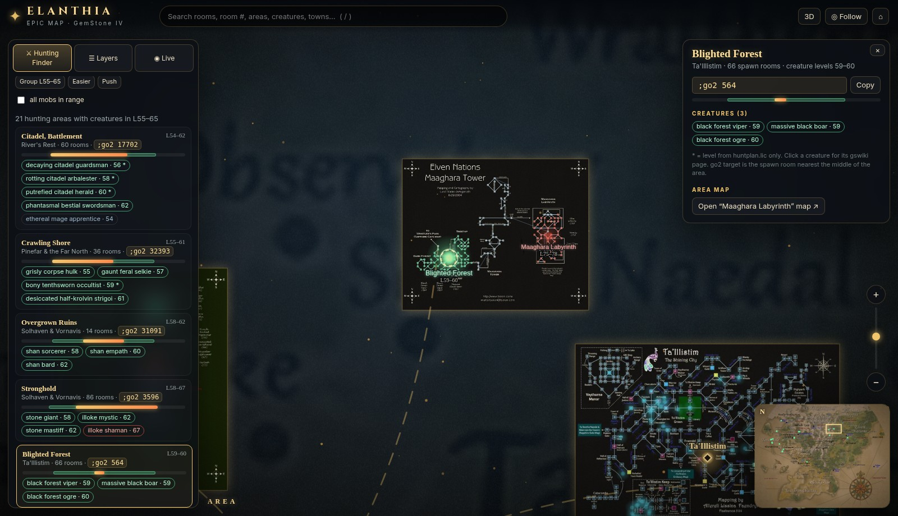
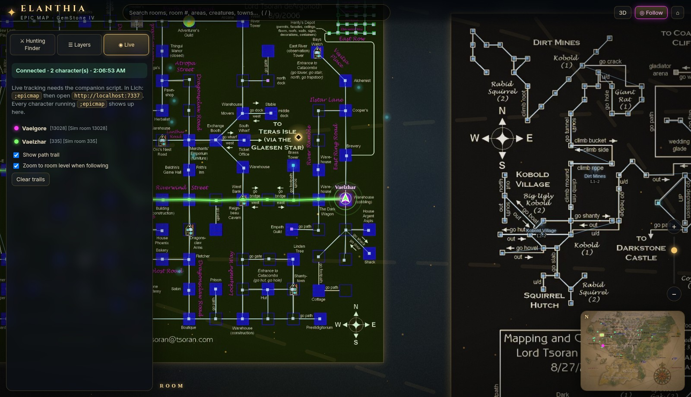
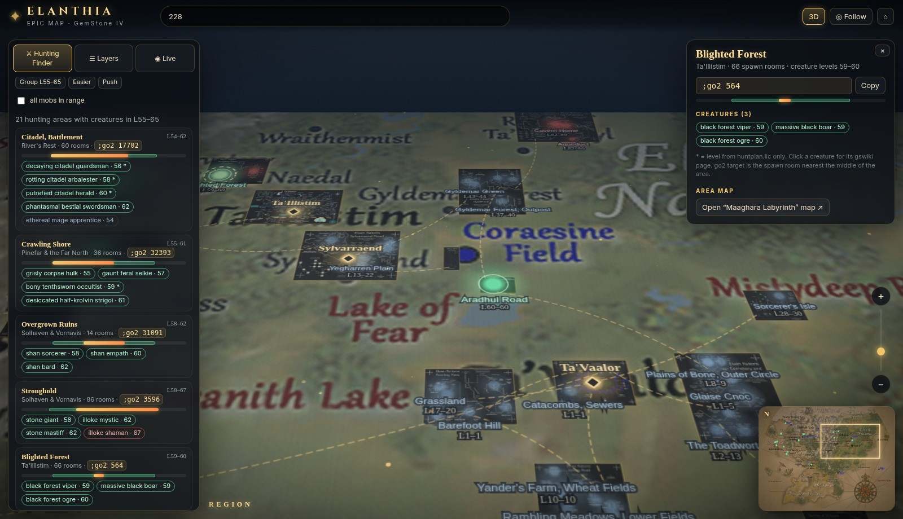

# EpicMap

Interactive GemStone IV world map with connected areas, hunting level filters, live character tracking, fading movement trails, and customizable map layers. Works with Lich.

[Download the latest release](https://github.com/WIdowDark30/EpicMap/releases/latest)

## Download and install

[**Download the latest release**](https://github.com/WIdowDark30/EpicMap/releases/latest) and pick the ZIP that fits:

- **New users:** the complete `epicmap-vX.Y.Z.zip` includes all maps, data and the Lich companion script.
- **Existing users:** the smaller `epicmap-vX.Y.Z-update.zip`, when a release has one, updates the previous release. Merge its `EpicMap` folder into your existing installation and keep your existing maps and room data.

1. Extract the ZIP and place the `EpicMap` folder in your Lich folder.
2. Copy `scripts/epicmap.lic` into your Lich scripts folder.
3. Run `;epicmap` in game. Use `;epicmap noopen` for additional characters.

Existing users can replace their `EpicMap` folder and reload with **Ctrl+F5**. Each release's notes say whether the Lich companion changed.

See [CHANGELOG.md](CHANGELOG.md) for what changed in each version and [docs/USER_GUIDE.md](docs/USER_GUIDE.md) for the full guide, which is the `README.md` inside the download.

## Screenshots

### World map
Explore Elanthia and see hunting areas highlighted for your selected level range.



### Hunting finder
Filter hunting areas by level and region, inspect creatures, and copy a `;go2` command.



### Live character tracking
Follow multiple characters and see their recent movement trails through the Lich companion script.



### Tilted view
Switch to a tilted perspective to explore how towns and area maps connect.



The world overview screenshot shows v1.2.5; the other examples are from v1.2.1. Visible layers and settings can differ from the default view. Map artwork and data credits are included in the release README.

## Repository layout

| Path | Contents |
|---|---|
| `EpicMap/` | The browser app: HTML, JavaScript, CSS, room data (`gs4map-data.js`) and map images. |
| `scripts/epicmap.lic` | The Lich companion script that serves the map and tracks characters. |
| `screenshots/` | Screenshots shipped in the download. |
| `tests/` | Offline regression tests and the headless browser check. |
| `docs/` | The user guide shipped in the download as `README.md`, and the screenshots on this page. |
| `tools/release.cjs` | Builds the release ZIPs and release notes. |

The release ZIP holds the repository files apart from those marked `export-ignore` in `.gitattributes`.

## Development

Requires Node.js 20 or newer.

```bash
npm ci
npx playwright install chromium
npm run check          # syntax check
npm test               # offline regression tests
npm run test:browser   # headless browser checks
```

## Releasing

1. Bump `version` in `package.json`.
2. Add a `## [X.Y.Z] - YYYY-MM-DD - Title` section to the top of `CHANGELOG.md`. It becomes the release notes.
3. Update the version and notes in `docs/USER_GUIDE.md`, `UPDATE.txt` and `INSTALL-UPDATE.txt`.
4. Merge to `main`, then either push a `vX.Y.Z` tag or run the **Release** workflow from the Actions tab.

The workflow runs every test, then builds the complete ZIP and an update ZIP holding only the files changed since the previous release. It writes `SHA256SUMS.txt`, generates the download, installation and verification notes, and publishes the release. Pull requests run the same build as a dry run, without publishing.

